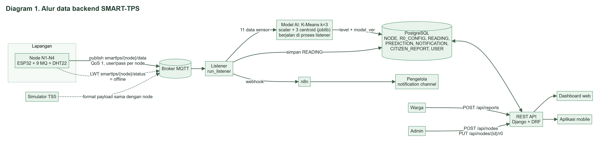

# Backend SMART-TPS

*Backend* SMART-TPS menerima data dari empat *node* lewat MQTT, menentukan tingkat bau tiap *node* dengan K-Means, menyimpan hasilnya ke *database*, dan menyediakan REST API untuk *dashboard web* dan aplikasi *mobile*. Notifikasi ke pengelola dikirim lewat n8n.

> **Status:** rancangan. Kode *backend* baru belum ada di folder ini. Dokumen ini adalah hasil issue #10 dan menjadi acuan issue BE berikutnya. Kode lama (SMART-TPS satu *node*) dipakai sebagai titik awal.

## Arsitektur



| Diagram | Isi |
| --- | --- |
| [Diagram 1](../../dokumentasi/backend/Diagram_Alur_Backend_1_Umum.png) | Alur data dari *node* sampai *dashboard* |
| [Diagram 2](../../dokumentasi/backend/Diagram_Alur_Backend_2_Listener.png) | Langkah *listener* untuk tiap pesan MQTT |
| [Diagram 3](../../dokumentasi/backend/Diagram_Alur_Backend_3_Node_Offline.png) | Deteksi *node offline* |

Daftar perbedaan dengan kode lama ada di [Daftar_Perubahan_Backend_SMART-TPS.txt](../../dokumentasi/backend/Daftar_Perubahan_Backend_SMART-TPS.txt).

## Teknologi

| Bagian | Teknologi |
| --- | --- |
| *Framework* | Django 5, Django REST Framework (*token authentication*) |
| *Database* | PostgreSQL 15 |
| MQTT *client* | paho-mqtt, dijalankan sebagai *management command* `run_listener` |
| Model AI | K-Means k=3 dan *scaler* (scikit-learn), dimuat dengan joblib |
| *Deployment* | Docker Compose: `db`, `web` (gunicorn), `listener`, `nginx` |
| Notifikasi | *Webhook* ke n8n |

## Data sensor

Tiap *node* mengirim **11 data sensor** per pembacaan. Kesebelas data ini disimpan dan dipakai sebagai fitur K-Means.

| Data | Jumlah | Satuan |
| --- | --- | --- |
| Sensor MQ-2, MQ-3, MQ-4, MQ-5, MQ-6, MQ-8, MQ-9, MQ-135, MQ-136 | 9 | *resistance ratio* (Rs/R0) |
| Suhu (DHT22) | 1 | °C |
| Kelembapan (DHT22) | 1 | %RH |

*Resistance ratio* (Rs/R0) adalah hambatan sensor saat ini dibagi hambatan sensor yang sama pada kondisi acuan (R0). Nilai sekitar 1 berarti udara mendekati kondisi acuan. Makin kecil nilainya, makin banyak gas. Firmware menghitung rasio ini. R0 tiap sensor disimpan di tabel `R0_CONFIG`.

## MQTT

| Topik | Arah | QoS | Isi |
| --- | --- | --- | --- |
| `smarttps/{node}/data` | *node* ke *broker* | 1 | 11 data sensor (JSON) |
| `smarttps/{node}/status` | *broker* ke *listener* (LWT) | 1 | `offline` saat *node* terputus |

*Listener* berlangganan `smarttps/+/data` dan `smarttps/+/status`. Tiap *node* login ke *broker* dengan nama pengguna dan kata sandi sendiri.

Contoh *payload*. Format final menunggu issue #5, dan angka di bawah hanya ilustrasi:

```json
{
  "node": "N1",
  "seq": 128,
  "ts": "2026-11-05T08:30:00+07:00",
  "rsr0": {
    "mq2": 0.91, "mq3": 0.88, "mq4": 0.95, "mq5": 0.90, "mq6": 0.93,
    "mq8": 0.97, "mq9": 0.89, "mq135": 0.84, "mq136": 0.86
  },
  "suhu": 31.2,
  "kelembapan": 74.5
}
```

| Kunci | Keterangan |
| --- | --- |
| `node` | Penanda *node* (N1-N4) |
| `seq` | Nomor urut pesan. Naik 1 tiap siklus dan dipakai menghitung *packet loss* |
| `ts` | Waktu pembacaan dari NTP (ISO 8601). Bila kosong, *server* memakai waktu terima |
| `rsr0` | Sembilan *resistance ratio* |
| `suhu`, `kelembapan` | Data DHT22 |

## Database

| Tabel | Kolom utama | Catatan |
| --- | --- | --- |
| `NODE` | node_id (PK, "N1"), nama, lokasi, pos_x, pos_y, aktif | pos_x dan pos_y adalah posisi *node* pada denah |
| `R0_CONFIG` | r0_id, node_id (FK), sensor, nilai_r0, diukur_pada | R0 aktif = baris terbaru per (*node*, sensor) |
| `READING` | reading_id, node_id (FK), seq, waktu, mq2 ... mq136, suhu, kelembapan | Kunci unik (node_id, seq), *index* (node_id, waktu) |
| `PREDICTION` | pred_id, reading_id (FK, unik), level, model_ver, waktu | Satu pembacaan, satu prediksi |
| `NOTIFICATION` | notif_id, node_id (FK), pred_id (FK, boleh kosong), jenis, pesan, waktu, status_kirim | jenis: tinggi atau offline |
| `CITIZEN_REPORT` | report_id, node_id (FK, boleh kosong), waktu, tingkat_dirasakan, deskripsi, status, handled_by (FK USER) | status: baru, diproses, selesai |
| `USER` | Model `AbstractUser` Django ditambah kolom peran | peran: pengelola atau admin |

Relasi: satu `NODE` punya banyak `READING`, `R0_CONFIG`, dan `NOTIFICATION`. Satu `READING` menghasilkan satu `PREDICTION`.

## REST API

| Metode | *Endpoint* | Pengguna | Fungsi |
| --- | --- | --- | --- |
| POST | `/api/auth/login` | pengelola, admin | Mengembalikan *token* |
| GET | `/api/status` | *dashboard*, *mobile* | Status TPS gabungan dan tingkat tiap *node* |
| GET | `/api/nodes/{id}/readings?from=&to=` | *dashboard*, *mobile* | Riwayat pembacaan dan tingkat bau, dengan paginasi |
| GET | `/api/nodes/{id}/trend` | *dashboard*, *mobile* | Tren naik, stabil, atau turun |
| POST | `/api/reports` | warga | Mengirim laporan bau |
| GET, PATCH | `/api/reports` | pengelola | Melihat laporan dan mengubah statusnya |
| GET | `/api/export?from=&to=` | pengelola | CSV pembacaan dan tingkat bau |
| POST, PUT | `/api/nodes`, `/api/nodes/{id}/r0` | admin | Mendaftarkan *node* dan menyimpan R0 |

## Aturan sistem

| Aturan | Isi |
| --- | --- |
| Tingkat bau | K-Means memilih rendah, sedang, atau tinggi dari 11 data sensor |
| Status TPS | Ikut *node* aktif yang tingkatnya paling tinggi |
| Tren | Dilihat dari 15 prediksi terakhir: naik, stabil, atau turun |
| *Node offline* | Tidak mengirim data lebih dari 3 menit |
| Notifikasi | Dikirim saat satu *node* tinggi 3 kali berturut-turut, atau saat *node offline*. Notifikasi tinggi untuk *node* yang sama tidak diulang dalam 30 menit |

Rumus tren (kode rendah = 0, sedang = 1, tinggi = 2, ambang kemiringan ±0,05) ada di proposal dan ditetapkan saat issue #27.

## *Environment variable*

Nilai rahasia disimpan di file `.env` yang tidak ikut di-*commit*. Jangan tulis kata sandi di kode atau di `docker-compose.yml`.

| Variabel | Fungsi | Keterangan |
| --- | --- | --- |
| `DJANGO_SECRET_KEY` | *Secret key* Django | Dari kode lama |
| `DEBUG` | `0` untuk *server*, `1` untuk lokal | Dari kode lama |
| `ALLOWED_HOSTS` | *Host* yang diizinkan, dipisah koma | Dari kode lama |
| `DB_HOST`, `DB_PORT`, `DB_NAME`, `DB_USER`, `DB_PASS` | Koneksi PostgreSQL | Dari kode lama |
| `MQTT_HOST`, `MQTT_PORT`, `MQTT_USER`, `MQTT_PASS` | Koneksi *broker* untuk *listener* | Baru |
| `N8N_WEBHOOK_URL` | URL *webhook* n8n | Baru |

Nama variabel yang ditandai "Baru" masih usulan. Variabel itu ditetapkan saat issue #12 dan #29 dikerjakan.

## Menjalankan

Perintah di bawah berlaku setelah kode dan `docker-compose.yml` tersedia.

```bash
cp .env.example .env          # isi nilai rahasia
docker compose up -d --build
docker compose exec web python manage.py migrate
docker compose exec web python manage.py createsuperuser
```

Uji tanpa alat dilakukan dengan simulator yang mengirim data TS5 untuk N1-N4 (issue #13).

## Keputusan yang masih terbuka

| No | Keputusan | Pilihan | Terkait |
| --- | --- | --- | --- |
| 1 | Nama tingkat bau | rendah/sedang/tinggi (proposal, README utama) atau Normal/Sedang/Tinggi (issue AI) | #11, #26 |
| 2 | Format final *payload* | Contoh di atas, termasuk `suhu` dan `kelembapan` | #5 |
| 3 | `seq` kembali ke 0 saat ESP32 *restart* | Firmware menyimpan `seq` di NVS, atau *payload* ditambah `boot_id` | #5, #11 |
| 4 | Data pelapor dan foto laporan warga | Warga anonim, atau warga punya akun (tambah peran warga) | #11 |
| 5 | DHT22 gagal membaca | Pembacaan ditolak, atau disimpan tanpa prediksi | #12, #26 |
| 6 | Penyedia *cloud* | Belum dipilih | #37 |

## Issue backend

| Issue | Judul |
| --- | --- |
| #10 | Analisis dan dokumentasi arsitektur backend |
| #11 | Ubah model database: 9 sensor, suhu, dan kelembapan |
| #12 | Listener MQTT multi-node |
| #13 | Simulator data sensor dari dataset TS5 |
| #26 | Integrasi model K-Means ke listener |
| #27 | API status gabungan TPS dan tren |
| #28 | Deteksi node offline |
| #29 | Notifikasi n8n |
| #30 | Pengamanan backend dan broker MQTT |
| #40 | Uji integrasi end-to-end |
| #41 | Uji keamanan MQTT dan REST API |
